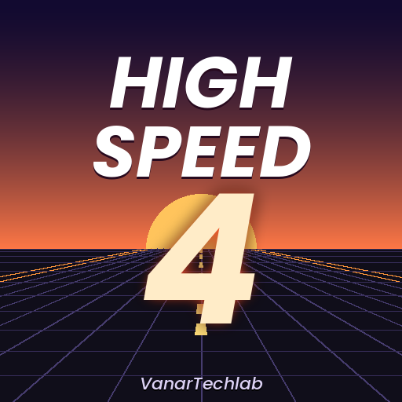

  

# High Speed 4

**High Speed 4** es un port para PC (Windows) de *Need for Speed: High Stakes* de PlayStation,
hecho por **Vanar (VanarTechlab)** con la recompilación estática de
[PSXRecomp](https://github.com/RetroPortingToolKit/psxrecomp) y el lanzador
[recomp-ui](https://github.com/RetroPortingToolKit/recomp-ui).

No es un emulador: el código del juego de PlayStation se traduce a código nativo de PC.
**Gratis y sin ánimo de lucro.**

## Qué mejora
- Hasta 60 imágenes por segundo en carrera, sin las ralentizaciones de la PlayStation.
- Pantalla panorámica 16:9 real (más campo de visión, HUD ajustado).
- Resolución interna alta (1080p, 4K...).
- Jukebox: elige el tema musical en el menú de pausa.
- Texturas HD opcionales con `Texturas HD.exe`: pack descargable aparte, o creadas desde **tu** partida con Real-ESRGAN.

## Qué necesitas
- **Tu propia copia original** de *Need for Speed: High Stakes* para PlayStation,
  versión **USA (NTSC-U, SLUS-00826)**, volcada a imagen **.cue + .bin**.
- Windows 10/11 de 64 bits y una tarjeta gráfica con OpenGL 3.3.
- **No hace falta BIOS**: se incluye OpenBIOS (libre). Si quieres, puedes usar tu propia BIOS.

## Instalación
1. Descarga `HighSpeed4_vX.Y.Z.zip` desde [Releases](../../releases) o desde
   [vanartechlab.pages.dev](https://vanartechlab.pages.dev) y descomprímelo entero.
2. Abre **`Instalar High Speed 4.exe`**, pulsa **Buscar...** y elige el archivo **.cue** de tu disco.
3. Elige la carpeta y pulsa **INSTALAR**. El instalador comprueba tu disco, copia el juego, descarga el
   compilador clang (gratuito) y traduce el código del juego **desde tu disco** (unos minutos).
4. Instrucciones completas y controles: `LEEME.txt` dentro del zip.

## Aviso legal
Este proyecto **no incluye** ningún juego, imagen de disco, código ni arte de Electronic Arts,
ni ninguna BIOS de Sony. *Need for Speed* y *High Stakes* son marcas de Electronic Arts Inc.;
*PlayStation* es una marca de Sony Interactive Entertainment. High Speed 4 **no está afiliado,
patrocinado ni aprobado** por ellos. Más detalles en [LICENCIAS.md](LICENCIAS.md).

## Licencia
Código propio: [MIT](LICENSE). PSXRecomp: PolyForm Noncommercial 1.0.0 + permiso para
donaciones. Ver [LICENCIAS.md](LICENCIAS.md).

## Apoyar el proyecto
High Speed 4 es y será gratis. Si quieres apoyar mi trabajo, puedes hacerlo de forma
**voluntaria** (no compra acceso a nada):
- Ko-fi y Fourthwall: [vanar-techlab-shop.fourthwall.com](https://vanar-techlab-shop.fourthwall.com)
- Canal de YouTube: [VanarTechlab](https://youtube.com/@VanarTechlab)

## Compilar desde el código
Ver `psxrecomp/docs/GAME_PROJECT_SETUP.md`. Hace falta tu disco para generar el código del juego.

---

## English
**High Speed 4** is a free, non-commercial PC (Windows) port of the PlayStation game
*Need for Speed: High Stakes*, made with PSXRecomp static recompilation. You need your own
original NTSC-U disc (SLUS-00826) as .cue/.bin; the game code is translated and compiled on
your PC from your disc. No BIOS needed (OpenBIOS included). Not affiliated with or endorsed
by Electronic Arts or Sony. See [LICENCIAS.md](LICENCIAS.md).
